<p align="center">
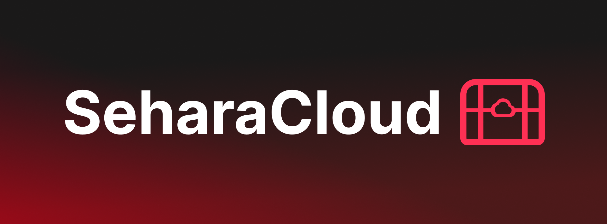 
</p>

---
Self-hosted media cloud for music, video, documents, and images. Files are automatically indexed (C++ daemon), metadata is stored in PostgreSQL, and a REST API (ASP.NET Core) serves them to clients (mobile app, web frontend...).


This README covers the backend portion (indexer + API + database + deployment) and the Android mobile app. The frontend builds upon the API contract described here.

---

## Table of Contents

* [Architecture](#architecture)
* [Tech Stack](#tech-stack)
* [Project Structure](#project-structure)
* [Getting Started](#getting-started)
* [Data Customization & Workflow](#data-customization--workflow)
* [Environment Variables (.env)](#environment-variables-env)
* [appsettings.Production.json](#appsettingsproductionjson)
* [Indexer — Expectations and Inner Workings](#indexer--expectations-and-inner-workings)
* [Database](#database)
* [API](#api)
* [Mobile App — Overview](#mobile-app--overview)
* [Mobile App — Features](#mobile-app--features)
* [Mobile App — Screenshots](#mobile-app--screenshots)
* [Mobile App — Tech Stack](#mobile-app--tech-stack)
* [Mobile App — Project Structure](#mobile-app--project-structure)
* [Mobile App — Getting Started](#mobile-app--getting-started)
* [Mobile App — Configuring the API Base URL](#mobile-app--configuring-the-api-base-url)
* [Mobile App — Build & Run](#mobile-app--build--run)

---

## Architecture

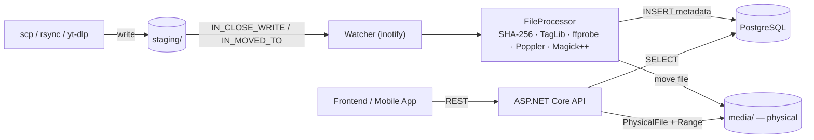

### Typical file lifecycle:

1. **File arrives in `staging/`** (scp, rsync, or yt-dlp downloads mp3 directly there).
2. **Watcher captures `IN_CLOSE_WRITE` / `IN_MOVED_TO`** (i.e., only after the write operation is complete — see the atomic write note below).
3. **FileProcessor calculates SHA-256**, checks for duplicates (`fn_find_duplicate`), extracts metadata based on file type, and generates a `.webp` thumbnail if needed.
4. **File is moved from `staging/` to the final physical directory**; the logical path (`/mnt/cloud/...`) is written to the database, not the physical one.
5. **API reads from the database** and serves files from its mount point (same host folder, different path inside the container — see below).
6. **Frontend calls REST endpoints**; `ThumbnailUrl` in the response is already a full URL, ready for `` / `<Image>`.

---

## Tech Stack

| Layer | Technology |
| --- | --- |
| **Indexer** | C++17, libpqxx, TagLib, Magick++, poppler-cpp, OpenSSL, inotify |
| **API** | ASP.NET Core (.NET 9), Dapper, Npgsql |
| **Database** | PostgreSQL 16 (pgcrypto, pg_trgm) |
| **Deployment** | Docker Compose, 3 services: `seharacloud-db`, `seharacloud-api`, `seharacloud-indexer` |

---

## Project Structure

```text
/data/configs/seharacloud/api/
├── client/SeharaCloud.MobileApp/   # Android mobile app
├── database/schema.sql             # complete DDL, seed data, functions
├── docker-compose.yml              # template (without real credentials)
├── docs/ApiContract.md             # full API contract (source of truth for endpoints)
├── env.example                     # template for .env
├── server/
│   ├── api/SeharaCloud.api/        # ASP.NET Core API
│   └── indexer/                    # C++ inotify daemon

```

The repository (this folder) contains template files (`docker-compose.yml`, `env.example`) without real credentials. The actual `.env` and `appsettings.Production.json` files with production values reside separately on the server at `/data/docker/seharacloud/` and are never committed.

---

## Getting Started

**Prerequisites:** Docker, Docker Compose, git.

```bash
git clone https://github.com/SamerKolasevic29/SeharaCloud.git seharacloud
cd seharacloud

# 1. Environment & Config
cp env.example .env
cp appsettings.Production.json.example appsettings.Production.json
# Edit .env and appsettings.Production.json with your actual credentials

# 2. Build & Start Containers
docker compose up -d --build

# 3. Initialize Database (Crucial Step)
docker exec -i seharacloud-db psql -U postgres -d seharacloud-db < database/schema.sql

# 4. Setup Default Thumbnails
# Ensure your host media folders (videos, images, music, documents, thumbnails, staging) exist.
# Copy default thumbnails from the repo to your media/thumbnails/ folder:
cp -r docs/DefaultThumbnails/* /path/to/your/media/thumbnails/
```

## Data Customization & Workflow

By default, every new song processed by the indexer will be assigned to an "Unknown Artist" and "Unknown Genre". If you want your media properly organized, follow these steps before dropping files into the `staging` folder.

### 1. Setting up Genres

You can find pre-made thumbnails for common genres inside `docs/GenreThumbnails`. To add a genre to the database:

* Insert the genre (note that `thumbnail_id1` is already the default fallback, so you only map `thumbnail_id2`):
```sql
INSERT INTO genres (name, thumbnail_id2) 
VALUES ('Rock', 'your-thumbnail-uuid-here');
```

* List your genres to get their IDs for later use:
```sql
SELECT id, name FROM genres;
```

### 2. Setting up Artists & Thumbnails

Find up to two images for your artist (e.g., `Artist.jpg`, `Artist2.png`), place them in a folder, and convert them to the required `.webp` format using this script:

```bash
# Run this inside your image folder to convert jpg/jpeg/png/webp to standard webp
for file in *.{jpg,jpeg,png,webp}; do
  if [ -f "$file" ]; then
    filename=$(basename "$file")
    name="${filename%.*}"
    ffmpeg -i "$file" -vf scale=512:512 "${name}Thumbnail.webp"
  fi
done
```

* Move the generated `ArtistThumbnail.webp` and `Artist2Thumbnail.webp` to your `media/thumbnails/` folder.
* Insert the artist into the database and link them to the previously created genre ID:
```sql
INSERT INTO artists (name, genre_id, thumbnail_id2, thumbnail_id3) 
VALUES ('Smoke Mardeljano', 'genre-uuid-here', 'artist-thumb-uuid', 'artist2-thumb-uuid');
```

### 3. Triggering the Indexer

The indexer relies heavily on filename parsing.

* Rename your audio files exactly to this format: `Artist - SongName.mp3` (or `.wav`).
* Drop them into the `staging/` directory. The indexer will read the filename, match the artist in the database, and link the song. If the filename doesn't match this structure, it falls back to "Unknown Artist".

---

## Environment Variables (.env)

| Variable | Description |
| --- | --- |
| `POSTGRES_USER` | DB user (used by both API and indexer) |
| `POSTGRES_PASSWORD` | DB password |
| `POSTGRES_DB` | Database name (`seharacloud-db`) |
| `DB_HOST` / `DB_PORT` | Internal database hostname/port within the docker network |
| `ASPNETCORE_ENVIRONMENT` | `Production` |
| `API_PORT` | Port the API listens on inside the container |
| `API_BIND_ADDRESS` | Host interface (`127.0.0.1` = local only, behind reverse proxy) |
| `API_BASE_URL` | Public API URL (e.g., `https://sehara.cloud.com`) — used for `ThumbnailUrl` and similar absolute links |
| `INDEXER_PHYSICAL_BASE_PATH` | Path as seen by the indexer container |
| `INDEXER_LOGICAL_BASE_PATH` | Path as seen by the API container (`/mnt/cloud`) — this is written to the DB as `path` |
| `HOST_MEDIA_PATH` | Actual path on the server where files reside |
| `HOST_DB_DATA_PATH` | Actual path on the server for the PostgreSQL data directory |

> **Important:** `HOST_MEDIA_PATH` is mounted in both containers, but at different internal paths — the indexer sees it as `PHYSICAL_BASE_PATH` (where it physically writes files), while the API sees it as `LOGICAL_BASE_PATH` (`/mnt/cloud`, where it serves `PhysicalFile` from). Therefore, the database stores the logical path, not the physical one — the API and indexer look at the same disk through two different "windows".

---

## appsettings.Production.json

```json
{
  "AppSettings": { "BaseUrl": "https://sehara.cloud.com" },
  "ConnectionStrings": {
    "DefaultConnection": "Host=seharacloud-db;Port=5432;Database=seharacloud-db;Username=clouduser;Password=..."
  }
}
```

In production, `docker-compose.yml` overrides both keys via environment variables (`AppSettings__BaseUrl`, `ConnectionStrings__DefaultConnection` — double underscore is the ASP.NET Core convention for nested JSON keys). This file serves as a fallback for local runs without Docker.

---

## Indexer — Expectations and Inner Workings

Watcher listens for `IN_CLOSE_WRITE | IN_MOVED_TO` on the staging directory — reacting only when the write operation completes, not when a file is created. Both `scp` (which writes directly to the final name) and `rsync` without `--inplace` (which writes to `.tmp` and renames) are safe for this pattern. For any other source filling the staging folder, the safest approach is write-to-temp + atomic rename on the same filesystem.

### Supported Formats

| Extension | Type | Metadata extracted from |
| --- | --- | --- |
| `.mp3`, `.wav` | Music | TagLib (duration, bitrate) + filename parsing `Artist - Title.mp3` |
| `.mp4` | Video | ffprobe (codec, resolution, duration) |
| `.pdf` | Document | Poppler (page count) |
| `.jpg`, `.jpeg`, `.png` | Image | Magick++ (dimensions + `.webp` thumbnail generation, max 512×512) |

### Deduplication

Each file is hashed (SHA-256) prior to insertion; `fn_find_duplicate()` checks the hash across all four tables (`UNION ALL`). If a duplicate is found, the file is deleted from staging and is not re-indexed.

---

## Database

Full DDL is located in `database/schema.sql` — this is just an overview.

| Table | Purpose |
| --- | --- |
| `thumbnails` | Central table for all thumbnail images (`path`, `mime_type`, dimensions) |
| `genres`, `artists` | Genres and artists, with fuzzy resolution (`pg_trgm`) via `fn_resolve_artist()` |
| `music`, `videos`, `documents`, `images` | Metadata by file type; each contains `size_bytes`, `file_hash`, `thumbnail_id` |

**Sentinel rows** — Unknown Genre, Unknown Artist, and default thumbnails for each file type exist as fixed UUIDs (seed data), protected against deletion by a trigger (`fn_protect_unknown_rows`). **Frontend takeaway:** no genre/artist/thumbnail field is ever `NULL` — a fallback always exists.

**Useful functions:**

* `fn_resolve_artist(name)` — exact match → fuzzy match (trigram) → fallback to "Unknown Artist"
* `fn_find_duplicate(hash)` — searches hash across all 4 tables
* View `v_artists_full` — artist + all three thumbnails + genre, joined

---

## API

Base URL comes from `API_BASE_URL` (e.g., `https://sehara.cloud.com`).
Full contract (including upcoming modules) is in `docs/ApiContract.md` — below is what is currently implemented and verified (Music module).

| Method | Route | Description |
| --- | --- | --- |
| `GET` | `/api/music` | All songs |
| `GET` | `/api/music/recent` | Last 20 (by `indexed_at`) |
| `GET` | `/api/music/artists` | All artists + song count |
| `GET` | `/api/music/artists/search?q=` | Artist search (ILIKE, min 2 characters) |
| `GET` | `/api/music/artists/{artistId}` | Songs by given artist |
| `GET` | `/api/music/genres` | All genres + song count |
| `GET` | `/api/music/genres/{genreId}` | Songs of given genre |
| `GET` | `/api/music/search?q=` | Title search (ILIKE, min 2 characters) |
| `GET` | `/api/music/{id}/stream` | File streaming, supports Range header (RFC 7233) |

`MusicDto`: `Id`, `Filename`, `ThumbnailUrl`, `SizeBytes`, `Title`, `Artist`, `Genre`, `DurationSec`

Short queries (< 2 characters) on search endpoints throw a validation error; `/stream` returns a not-found error if the ID does not exist in the database or if the file is physically missing from disk (`File.Exists` is checked prior to streaming). Exact HTTP status codes mapped by middleware — check `Middleware/` (not covered in this README).

Video/Document/Image endpoints are not yet confirmed in code — once completed, add them to this table following the same format.

---

## Mobile App — Overview

`client/SeharaCloud.MobileApp` is a native Android client for SeharaCloud. It talks to the REST API described above and gives you a single place to browse and play your self-hosted music, videos, documents, and photos from your phone.

The app is written entirely in **Kotlin** with **Jetpack Compose** and follows an MVVM-style structure: each screen has a `ViewModel` that exposes `StateFlow`s loaded through Retrofit, and the Compose UI simply collects them. A single shared `MusicPlayerViewModel` is connected to a Media3 `PlaybackService`, so music keeps playing in the background and survives navigation between screens.

The API address is **not hardcoded** — it is read from `local.properties` at build time and exposed to the code as `BuildConfig.BASE_URL` (see [Configuring the API Base URL](#mobile-app--configuring-the-api-base-url)).

---

## Mobile App — Features

**Music**

* Home screen with live search (min 2 characters), a "Recently added" section, and a sortable "All tracks" list (A–Z / Z–A, by title or by artist, using a `Collator` for the `bs` locale so č, ć, š, ž, đ are ordered correctly).
* Browse by **Artists** and **Genres**, each opening its own track list with the same sorting options.
* Mini and full-screen player with seek bar, previous/next, shuffle, and swipe on the cover art to change tracks. Tap the cover or the genre icon to jump to the artist or genre.
* Background playback with a media notification (Media3 `MediaSession`) and Range streaming.

**Video**

* Home screen with live search, a "Recently added" section, and a grid of all videos.
* Player with three modes: floating, portrait, and landscape fullscreen, plus seek bar and previous/next.

**Documents**

* Live search with "Recent" and "All" tabs.
* Built-in PDF viewer with vertical scrolling and double-tap zoom.

**Photos**

* Photo grid sorted by date (newest first), tap a photo to open it in the full-screen viewer.

> The app follows the API: modules whose endpoints are not yet finished on the backend (see the API section above) are only as complete as the server allows.

---

## Mobile App — Screenshots

<p align="center">
<table>
  <tr>
    <td>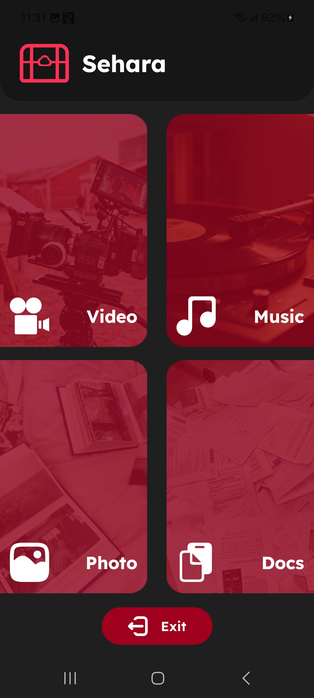</td>
    <td>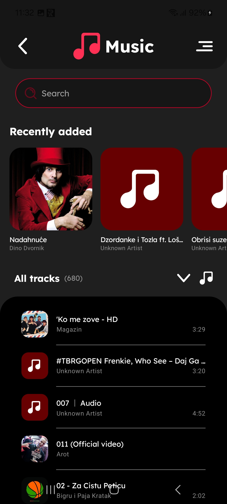</td>
    <td>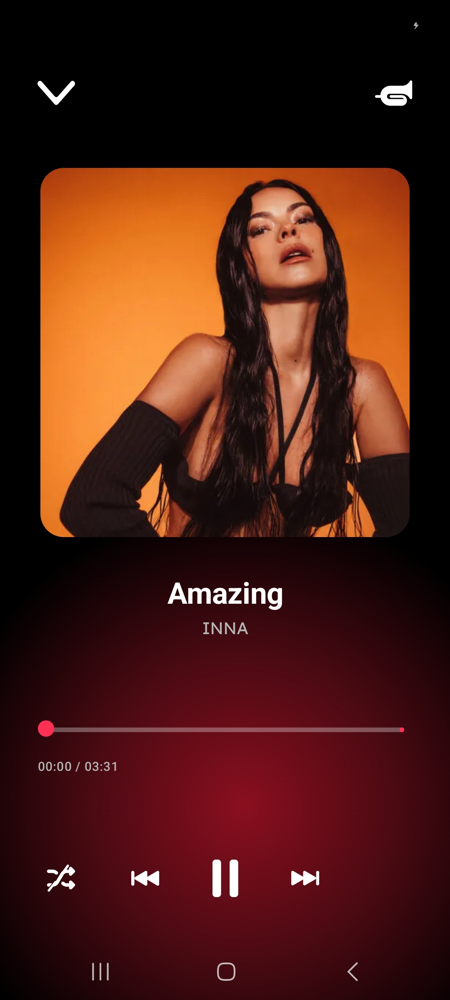</td>
  </tr>
  <tr>
    <td>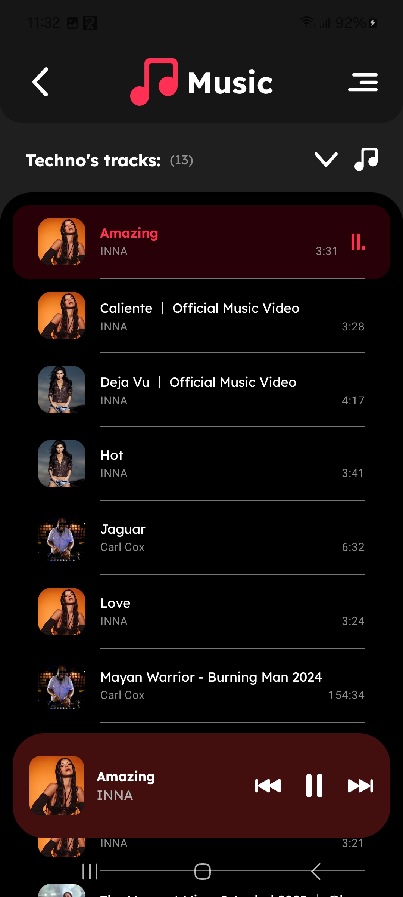</td>
    <td>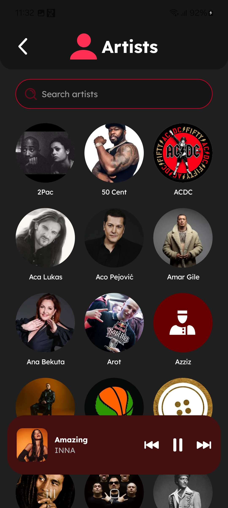</td>
    <td>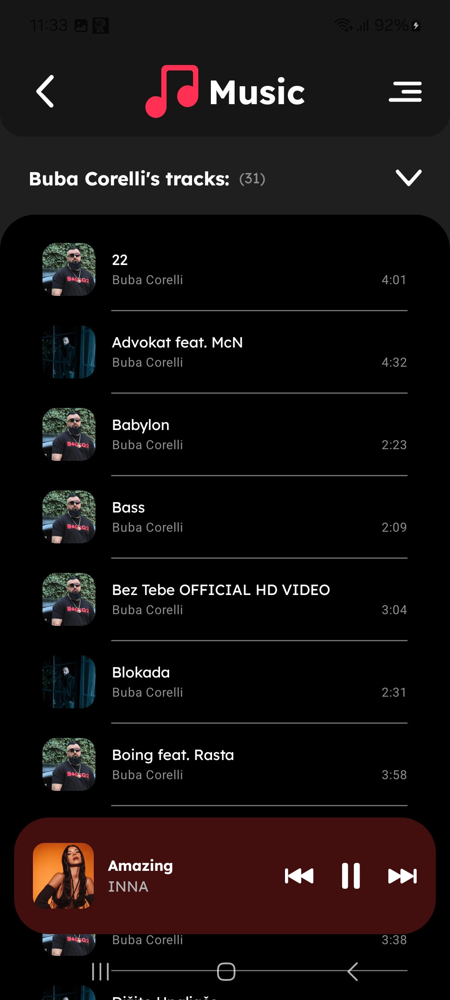</td>
  </tr>
  
  <tr>
    <td colspan="3" align="center">
      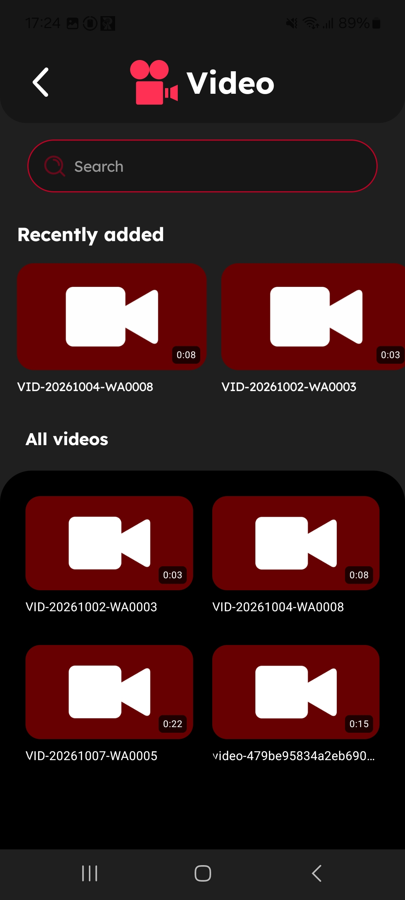
      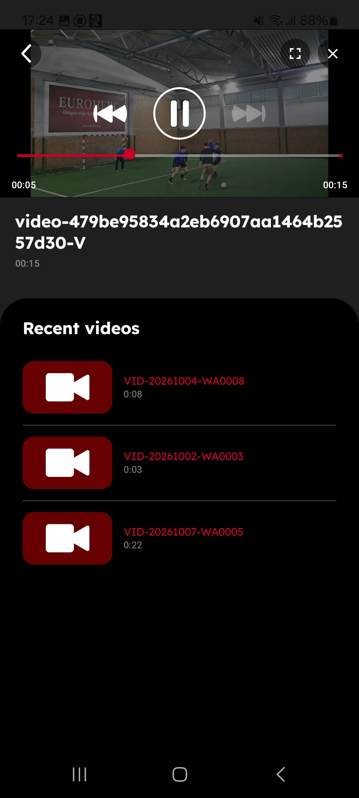
    </td>
  </tr>
  
  <tr>
    <td colspan="3" align="center">
      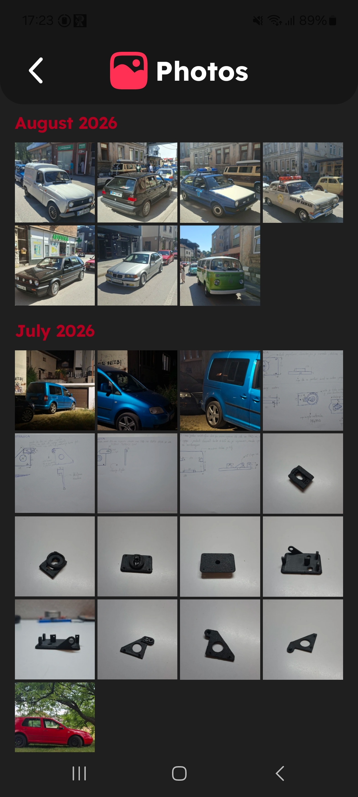
      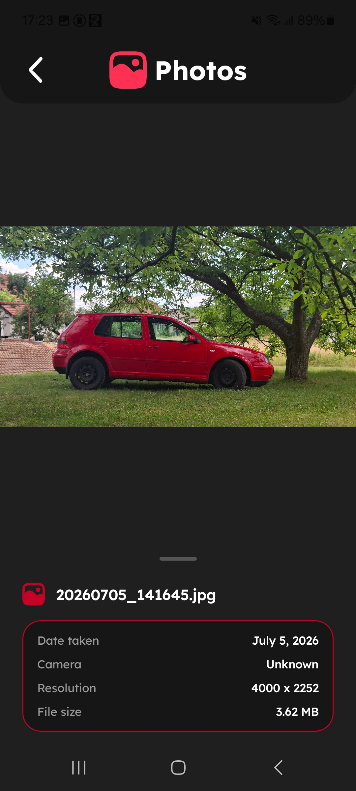
    </td>
  </tr>
  
  <tr>
    <td colspan="3" align="center">
      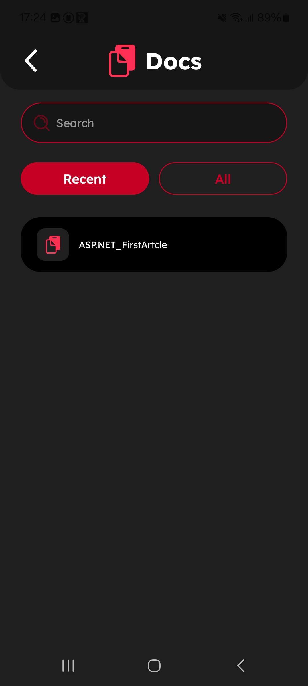
      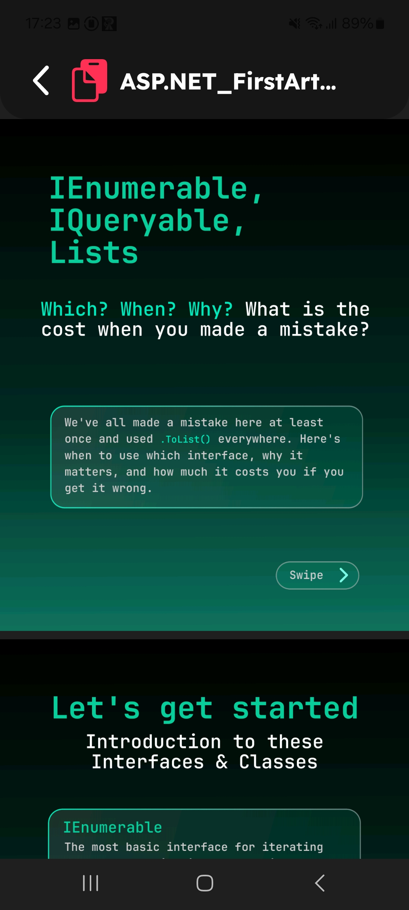
    </td>
  </tr>
</table>
</p>

---

## Mobile App — Tech Stack

| Layer | Technology |
| --- | --- |
| **Language** | Kotlin |
| **UI** | Jetpack Compose, Material 3 |
| **Navigation** | Navigation Compose 2.9.8 |
| **Architecture** | MVVM — `ViewModel` + `StateFlow` (Lifecycle KTX) |
| **Networking** | Retrofit 2.9.0 + Gson converter |
| **Images** | Coil 2.6.0 (`coil-compose`) |
| **Audio / Video** | AndroidX Media3 1.3.1 — ExoPlayer, UI, Session (`MediaSessionService` for background playback) |
| **PDF** | android-pdf-viewer 3.2.0-beta.3 (`com.github.mhiew`) |
| **Splash screen** | AndroidX Core SplashScreen 1.0.1 |
| **Build** | Gradle (Kotlin DSL), version catalog (`libs.versions.toml`) |
| **Target** | `minSdk` 26 (Android 8.0), `targetSdk` / `compileSdk` 36, Java 11 |

---

## Mobile App — Project Structure

```text
client/SeharaCloud.MobileApp/
├── build.gradle.kts                 # root Gradle config
├── local.properties.example         # template for local.properties (BASE_URL)
└── app/
    ├── build.gradle.kts             # module config, dependencies, BASE_URL -> BuildConfig
    ├── proguard-rules.pro
    └── src/
        ├── test/                    # unit tests
        ├── androidTest/             # instrumented tests
        └── main/
            ├── AndroidManifest.xml
            ├── java/com/devfamily/sehara/
            │   ├── MainActivity.kt          # single activity, hosts Compose + navigation
            │   ├── data/                    # API layer and models
            │   │   ├── RetroFitClient.kt    # Retrofit instance, reads BuildConfig.BASE_URL
            │   │   ├── ApiService.kt        # REST endpoint definitions
            │   │   ├── PlaybackService.kt   # Media3 MediaSessionService (background playback)
            │   │   ├── SongItem.kt
            │   │   ├── ArtistItem.kt
            │   │   ├── GenreItem.kt
            │   │   ├── VideoItem.kt
            │   │   ├── DocumentItem.kt
            │   │   └── PhotoItem.kt
            │   └── ui/
            │       ├── theme/                # Color.kt, Theme.kt, Type.kt
            │       ├── navigation/           # Routes.kt, AppNavigation.kt
            │       ├── components/           # reusable composables
            │       │   ├── AllTracksSection.kt
            │       │   ├── MusicListRow.kt
            │       │   ├── MusicPlayerOverlay.kt
            │       │   ├── VideoPlayerOverlay.kt
            │       │   ├── VideoListRow.kt
            │       │   ├── PhotoGridView.kt
            │       │   ├── PhotoDetailRow.kt
            │       │   ├── SearchBar.kt
            │       │   ├── MarqueeText.kt
            │       │   └── CategoryCard.kt
            │       └── screens/
            │           ├── landing/          # LandingScreen
            │           ├── home/             # HomeScreen (module picker)
            │           ├── music/            # MusicHomeScreen, ArtistScreen, GenreScreen, FavoriteScreen
            │           │                     # MusicListScreen, MusicFilter + ViewModels
            │           │                     # (Music, Artist, Genre, MusicList, MusicPlayer)
            │           ├── video/            # VideoHomeScreen, VideoViewModel, VideoPlayerViewModel
            │           ├── docs/             # DocumentsScreen, DocumentViewerScreen, DocumentsViewModel
            │           └── photo/            # PhotoScreen, PhotoHostScreen, PhotoViewerScreen, PhotoViewModel
            └── res/
                ├── drawable/                 # icons (ic_*.xml), card and splash backgrounds
                ├── font/                     # Lexend (regular, medium, semibold, bold)
                ├── mipmap-*/                 # launcher icons
                ├── values/ values-v29/       # colors, strings, themes
                └── xml/                      # network_security_config, backup and extraction rules
```

---

## Mobile App — Getting Started

**Prerequisites:**

* A running SeharaCloud backend reachable from your phone/emulator (see [Getting Started](#getting-started) above).
* [Android Studio](https://developer.android.com/studio) (recent stable version) with Android SDK 36 installed.
* An Android device or emulator running Android 8.0 (API 26) or newer.
* git.

```bash
git clone https://github.com/SamerKolasevic29/SeharaCloud.git seharacloud
cd seharacloud/client/SeharaCloud.MobileApp
```

---

## Mobile App — Configuring the API Base URL

The app does not ship with a server address. You provide yours in `local.properties`, which is read by `app/build.gradle.kts` and injected into `BuildConfig.BASE_URL`. This file is local to your machine and is never committed.

```bash
# 1. Create your local.properties from the template
cp local.properties.example local.properties

# 2. Edit it and set your API address
```

Content of `local.properties`:

```properties
# BASE_URL must end with "/"
BASE_URL=https://example.com/
```

Replace `https://example.com/` with the same public URL you set as `API_BASE_URL` in the backend `.env` (e.g., `https://sehara.cloud.com/`).

> **Important:**
> * `BASE_URL` **must end with a trailing slash (`/`)** — Retrofit refuses to start without it.
> * The value is baked into the app at build time. After changing it, rebuild the app (Android Studio: *Build → Rebuild Project*).
> * If `local.properties` already exists (Android Studio creates it automatically with the `sdk.dir` line), just add the `BASE_URL` line to it instead of overwriting the file.
> * For a plain `http://` server (e.g., local testing in your home network), allow that host in `app/src/main/res/xml/network_security_config.xml`, otherwise Android blocks cleartext traffic. From an emulator, the host machine is reachable at `10.0.2.2`.

---

## Mobile App — Build & Run

**Android Studio (recommended)**

1. Open the `client/SeharaCloud.MobileApp` folder in Android Studio.
2. Wait for the Gradle sync to finish.
3. Select a device or emulator (API 26+).
4. Press **Run** (`Shift + F10`).

**Command line**

```bash
cd client/SeharaCloud.MobileApp

# Build a debug APK
./gradlew assembleDebug

# Install on a connected device / running emulator
./gradlew installDebug
```

The debug APK is written to `app/build/outputs/apk/debug/app-debug.apk`.